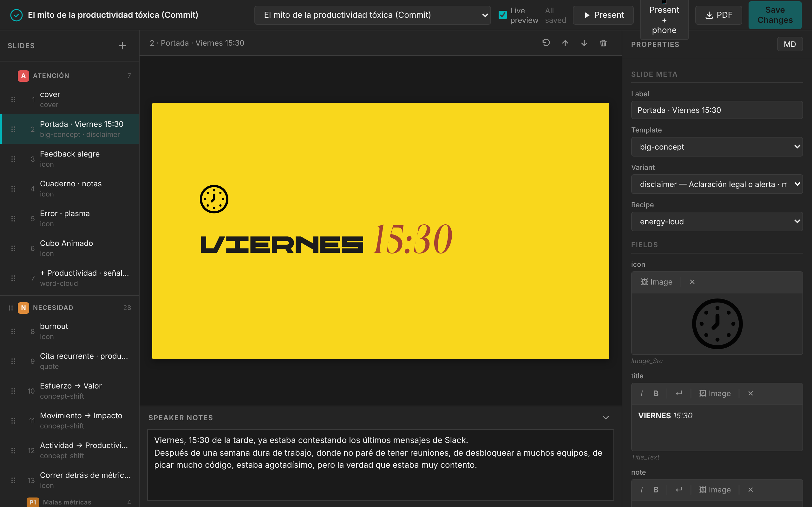
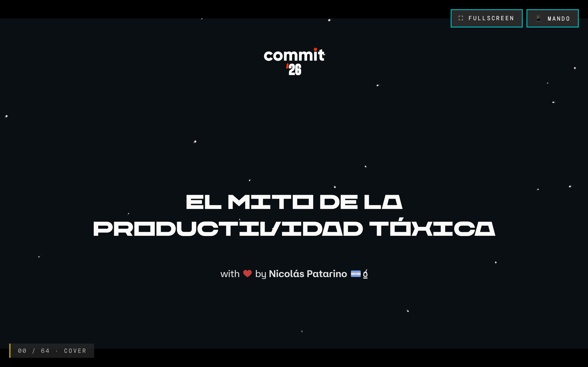
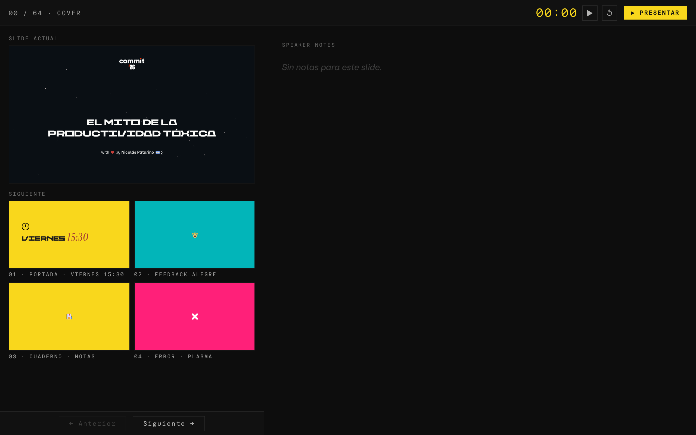
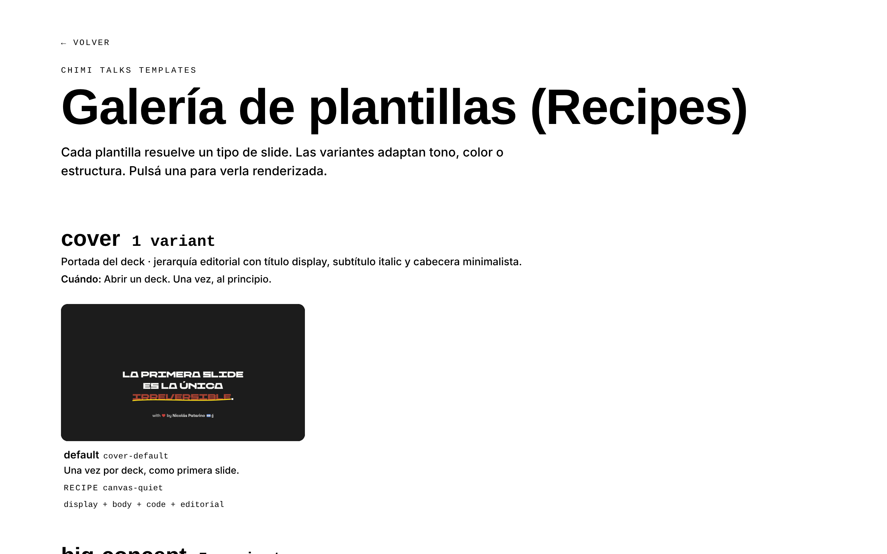

# cv-talks

[](https://github.com/npatarino/cv-talks/actions/workflows/ci.yml)

Chimichurri Code's **local-first** slide system. Each talk (deck) is a folder of Markdown files with YAML frontmatter, versioned with Git; Eleventy turns them into a static site with a player, a speaker view and a template gallery, and a local editor (Bun) lets you create and edit slides with a live preview. Slides are built on 43 templates that consume the design system's **recipes** (`@chimichurricode/design-system`), so the styling stays consistent without writing CSS per talk. There is no database: the file system is the source of truth.



## Features

- **Local editor** (`:3001`): slide list grouped by section with drag & drop, a form per template, live preview, speaker notes, per-slide Git status (revert to the committed version) and PDF export.
- **Player** at 1920×1080 scaled to the viewport, with keyboard navigation, fullscreen and automatic **mobile mode** (< 768px).
- **Speaker view** with the current slide, upcoming slides, notes and a timer.
- **Phone remote** via `/api/remote` (Vercel function + Redis, long polling).
- **Offline preload** (Service Worker): the talk keeps working if the network drops.
- **Template gallery** (`/talks/template-gallery/`) and a **meta mode** that shows field names instead of content.
- CLI to create decks and slides with the same code as the editor.

| Player | Speaker | Template gallery |
|---|---|---|
|  |  |  |

## Quick start

**Requirements:** [Bun](https://bun.sh) (scripts, editor and install; the project uses `bun.lock`) and Node.js (some scripts run with `node`). `servers:stop` needs `lsof`, `fuser` or `ss`.

```bash
git clone https://github.com/npatarino/cv-talks.git
cd cv-talks
bun install
bun run servers:start    # syncs fonts and starts Eleventy + the editor (Ctrl-C stops both)
```

- **Slides** → http://localhost:8080 (talk index; each deck at `/talks/decks/<slug>/deck/`)
- **Editor** → http://localhost:3001

If a port stays busy: `bun run servers:stop`.

## Common tasks

| Command | What it does |
|---|---|
| `bun run servers:start` / `servers:stop` | Starts / kills Eleventy (`:8080`) and the editor (`:3001`). |
| `bun run editor:start` | Editor only (needs Eleventy on `:8080` for the preview). |
| `bun run slides:serve` | Eleventy only, with live-reload. |
| `bun run slides:serve-meta` | Same, in meta mode (field names). |
| `bun run build` | Production build → `_site/` (fonts + Eleventy + SEO: icons, manifest, `robots.txt`, `sitemap.xml`). |
| `bun run test` | Unit and integration tests (Vitest). |
| `bun run test:watch` / `test:coverage` | Vitest in watch mode / with coverage. |
| `bun run test:e2e` | E2E with Playwright (starts its own editor on `:3101` over a fixture deck and the built site on `:3201`; it doesn't touch your decks). Requires the Playwright browsers (`bunx playwright install chromium`). |
| `bun run decks:format` / `decks:format-check` | Rewrites / checks slides in the canonical YAML. |
| `bun run fonts:sync` | Copies the design system fonts to `theme/styles/fonts/` (`servers:start` and `build` do it for you). |

For a build in meta mode: `SLIDE_MODE=meta bun run build`.

### Creating a new deck and slides

From the editor, or from the command line (same code as the editor):

```bash
node scripts/new-deck.mjs <slug> "<title>" ["<author>"] [--subtitle "..."] [--date YYYY-MM]
node scripts/new-slide.mjs <deck> <template> ["<label>"] [--variant V] [--recipe R] [--position N] [--slug S]
# e.g.: node scripts/new-deck.mjs mi-charla "Mi charla" "Nicolás Patarino"
# e.g.: node scripts/new-slide.mjs mi-charla big-stat "Big stat · burnout" --position 5
```

After creating a deck, restart Eleventy so it registers the deck's collection.

## Project structure

```
cv-talks/
├── decks/<slug>/          A deck: <slug>.11tydata.json, deck.config.json (order and sections), slides/*.md, *.njk
├── templates/             One sample slide per template/variant (feeds the gallery)
├── theme/
│   ├── _includes/         Nunjucks layouts (one per template), player, speaker, TOC, partials
│   ├── assets/            Browser JS: present.js, player, speaker, remote, offline
│   ├── lib/               Pure Eleventy logic
│   └── styles/            CSS
├── editor/
│   ├── server.mjs         Bun.serve: static UI + REST API
│   ├── api/               Layered backend (http → domain → store/services)
│   └── ui/                Frontend as ES modules, no bundler
├── api/remote.mjs         Remote relay (Vercel function)
├── _data/                 Eleventy global data (templates.json, site.js, build.js…)
├── scripts/               CLI: new-deck, new-slide, format-decks, build-seo, sync-fonts, start/stop-servers, screenshot-templates
├── tests/                 unit/, integration/, e2e/, helpers/, snapshots/ (template screenshots)
├── docs/                  Architecture and architecture review
└── eleventy.config.mjs    Eleventy config (reads decks with the same store as the editor)
```

Deck and slide format, editor layers, the API and how to add templates or endpoints: see **[docs/architecture.md](docs/architecture.md)**. The reasoning behind that structure is in [docs/architecture-review.md](docs/architecture-review.md).

## Configuration

Environment variables (all optional locally):

| Variable | Purpose |
|---|---|
| `EDITOR_PORT` | Editor port (default `3001`). |
| `ELEVENTY_URL` | Preview origin used by the editor (default `http://localhost:8080`). |
| `TALKS_DECKS_DIR` | Alternative decks folder (used by the e2e tests). |
| `SLIDE_MODE` | `meta` to render field names instead of content. |
| `KV_REST_API_URL`, `KV_REST_API_TOKEN` | Redis (Upstash) for the remote relay. Without them an in-memory Redis is used. Bun loads `.env.local` automatically, so if it exists **the local editor uses the real Redis**. |
| `VERCEL_GIT_COMMIT_SHA`, `VERCEL_DEPLOYMENT_ID` | Set by Vercel; they identify the build (name of the offline cache). |

## Deployment

Vercel, per [`vercel.json`](vercel.json): `bun install`, `bun run slides:build`, publishes `_site/` and the `api/remote.mjs` function (region `fra1`). In production only the static site and that function exist; the editor is local-only.

## Presenting

- **P** · toggle presentation mode (16:9 scaled to the viewport).
- **F** · fullscreen + presentation.
- **←** / **→** / **Space** · move between slides.
- **Esc** · exit.
- `?present=1` in the URL starts presenting right away.

### Before going on stage (offline)

The player stores the whole talk in the browser so a network outage goes
unnoticed. **Open the player in production while online and wait until you
see `OFFLINE ✓`** at the bottom right (a few seconds, only the first time for
each version). From then on you can lose the network: the slides, the speaker
view and reloading the player keep working. The phone remote does need the
network; without it, use the keyboard or a clicker, and it resyncs when the
network comes back.

- `offline ✗ N`: N files were missing; it retries on its own when the network comes back.
- `offline ↻ recarga`: there is a new version; reload (F5) while online.
- To try it locally: add `?offline=1`; `?offline=0` uninstalls it.

### Phone remote

The player (`/talks/decks/<slug>/deck/`) can be controlled from a phone
through `/api/remote` (Vercel function + Redis, long polling; no
WebSockets). Each player tab has its own private **room**, so several
presentations open at the same time never step on each other.

1. In the player press **R** (or the 📱 Mando button). The room is created and
   a **6-character code** appears with its QR. The code is **single-use** and
   expires after 10 min: even if the audience sees it, nobody can sneak in later.
2. On the phone open `/talks/decks/<slug>/speaker/?phone=1` and type the
   code, or scan the QR (which already includes it). The panel closes on its own
   once paired, and the HUD shows `📱 N` with the number of connected phones.
3. The phone follows the current slide and its notes, and sends ← / →. The
   session is stored on the phone (`localStorage`) and in the player tab
   (`sessionStorage`): reloading either one doesn't break anything.
4. **D** in the player unpairs every phone. ✕ on the phone leaves the room.
   The room dies after 12 h without activity.

`?remote=1` creates the room on load without waiting for R (this is what the
editor's "Present + phone" button uses). Locally the relay lives in the editor:
`deck/?api=http://localhost:3001/api/remote`, and the same on the phone.

## Render modes (presentation vs. mobile viewer)

Every deck and every individual slide expose two render modes that are
selected automatically and can be forced with a query param.

- **`view=presentation` (default ≥ 768px)** · each slide fills a fixed
  1920×1080 px canvas and `present.js` applies a `transform: scale(...)`
  to fit the viewport. The deck player is a single iframe with keyboard
  navigation.
- **`view=mobile` (default < 768px)** · each slide is re-rendered at
  `100vw × 100svh` with web-scale typography (defined in
  `theme/styles/viewer-mobile.css`); the deck player becomes a vertical
  stack of iframes with `scroll-snap-type: y mandatory`, so you swipe one
  slide per screen. Recipes and `--recipe-*` work the same in both modes.

```
/talks/decks/<slug>/deck/?view=presentation
/talks/decks/<slug>/deck/?view=mobile
/talks/decks/<slug>/<slide>/?view=mobile
```

The 768px breakpoint matches the design system's `--md` token. Slides
with dense layouts or `position: absolute` may need specific tweaks in
mobile mode (known follow-up).

## Templates → recipes

Each `templates/*.md` declares a recipe in its frontmatter; the layout passes
`recipe` to the `<section>` as `data-recipe="..."` and the CSS only consumes
`--recipe-{surface,ink,em,accent,warn}`. The full model (recipes, the
`critical-fg` pattern, the named exceptions) is in
[cv-design-system · docs/recipes.md](https://github.com/npatarino/cv-design-system/blob/main/docs/recipes.md).

```yaml
---
template: cover
recipe: canvas-quiet
order: 1
label: "Cover · default"
fields:
  ...
---
```

| # | Template | Recipe | Notes |
|---|---|---|---|
| 01 | cover-default | canvas-quiet | |
| 02 | speaker-bio-default | canvas-quiet | |
| 03 | agenda-default | paper | |
| 04 | big-concept-default | energy-loud | |
| 05 | big-concept-divider | cool-fresh | |
| 06 | big-concept-transition | canvas-quiet | italic editorial |
| 07 | big-concept-prompt | paper | |
| 08 | big-concept-disclaimer | critical (bg) | |
| 09 | quote-default | paper | |
| 10 | quote-xl | paper | |
| 11 | quote-testimonial | paper | |
| 12 | quote-punch | canvas-quiet | highlight em |
| 13 | quote-critical | canvas-quiet + `critical-fg-quote` | em plasma |
| 14 | social-embed-default | canvas-quiet | post = artifact |
| 15 | big-stat-default | canvas-signal | |
| 16 | big-stat-multiplier | canvas-signal | |
| 17 | big-stat-critical | canvas-signal + `critical-fg-stat` | numeral plasma |
| 18 | kpi-grid-default | canvas-signal | `allowMultipleAccents`+`Stats` |
| 19 | chart-bar | canvas-signal | `allowMultipleAccents`+`Stats` |
| 20 | chart-line | canvas-signal | `allowMultipleAccents`+`Stats` |
| 21 | comparison-table-default | canvas-signal | `allowMultipleStats` |
| 22 | three-ideas-default | canvas-signal | `allowMultipleAccents`+`Stats` |
| 23 | big-list-numeric | canvas-quiet | |
| 24 | big-list-bullets | canvas-quiet | |
| 25 | big-list-checklist | canvas-quiet | ✓/✗ boxes at big scale |
| 26 | big-list-glossary | canvas-quiet | 2-col grid: term + definition |
| 27 | big-list-critical | canvas-quiet + `critical-fg-marker` | bullets plasma |
| 28 | concept-shift-default | canvas-quiet | |
| 29 | matrix-default | canvas-quiet | `allowMultipleAccents` |
| 30 | code-block-default | canvas-quiet | |
| 31 | code-block-anti | canvas-quiet | warn-marked |
| 32 | stack-default | canvas-quiet | `allowMultipleAccents` |
| 33 | demo-default | canvas-quiet | browser = artifact |
| 34 | roadmap-default | canvas-quiet | |
| 35 | roadmap-timeline | canvas-quiet | |
| 36 | resource-cards-default | paper | |
| 37 | resource-cards-team | paper | |
| 38 | faq-default | paper | |
| 39 | closing-qr-default | paper | |
| 40 | closing-socials-default | canvas-quiet | `allowDeckOverride` |
| 41 | icon-default | paper | |
| 42 | word-cloud-default | canvas-dark | |
| 43 | media-still | canvas-quiet | |

Composite templates (with variants): `big-concept` (default/divider/transition/prompt/disclaimer), `quote` (default/xl/testimonial/punch/critical), `big-stat` (default/multiplier/critical), `big-list` (numeric/bullets/checklist/glossary/critical), `chart` (bar/line), `code-block` (default/anti), `roadmap` (default/timeline), `resource-cards` (default/team).

The named exceptions (`allowMultipleAccents`, `allowMultipleStats`, `allowDeckOverride`) live in the design system's [`tokens/type.recipe.json`](https://github.com/npatarino/cv-design-system/blob/main/tokens/type.recipe.json), under `_namedExceptions`.

## Dual-mode

Every field has a visible value and a meta label:

```yaml
eyebrow:
  content: "◆ Dato duro"     # normal render
  meta: "Eyebrow_Label"       # debug/review render
  source: "optional: traceability"
```

Global: `SLIDE_MODE=meta` (or `bun run slides:serve-meta`). Per-slide override: `mode: meta` in the frontmatter.

## Known issues

- The template screenshots in `tests/snapshots/baseline/` are stale: they were captured before templates were renumbered and renamed (e.g. `04-hero-title-default.png`), so they don't match `templates/*.md` anymore. Regenerate them with `bun run build && node scripts/screenshot-templates.mjs` before using them for comparisons.
